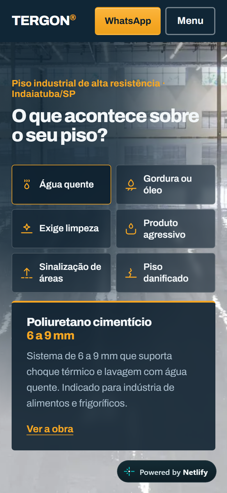
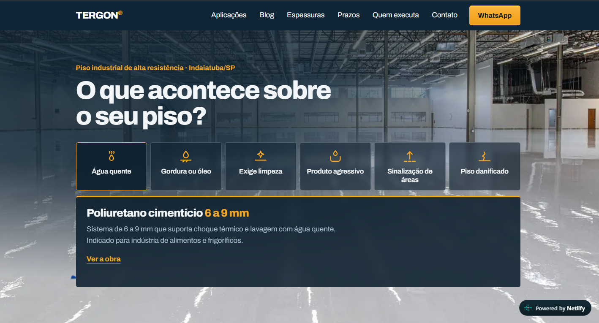
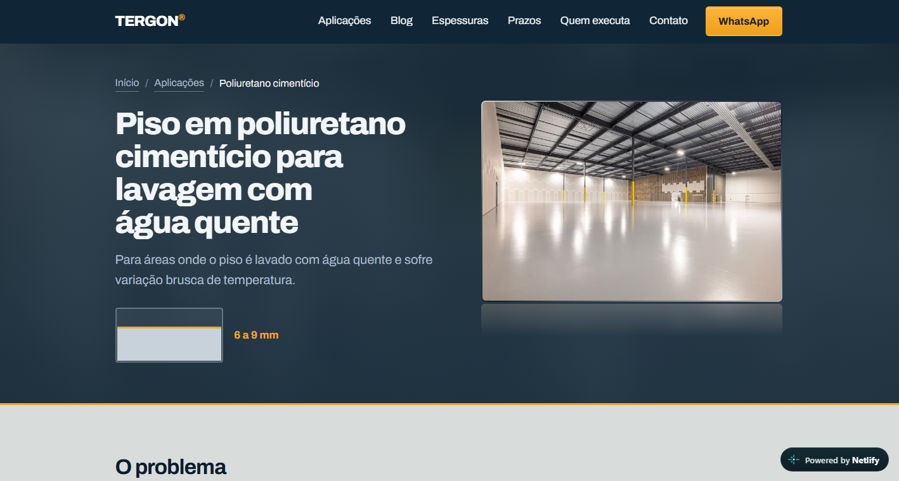
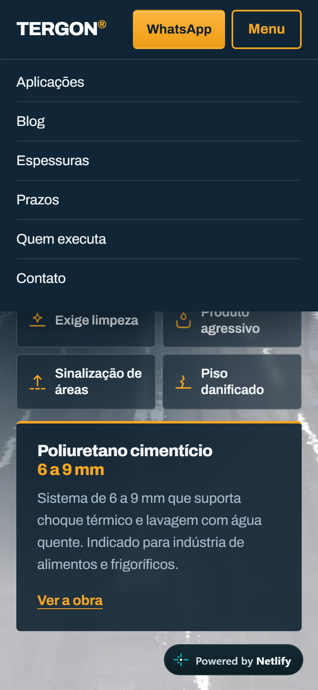

# Tergon Pisos Industriais: site de demonstração

 **English summary:** 12-page demo website for a fictional industrial flooring company, built in a Claude Code course: diagnosis, SEO audit before and after, a Python site generator and deployment on Netlify. [Live demo](https://demo-pisos-industriais-lbr.netlify.app/)
 
Site institucional de uma **empresa fictícia** de pisos industriais, feito do zero a partir de um anúncio antigo, como exercício do curso de Claude Code (Hashtag Treinamentos). O projeto percorre o caminho completo: leitura do cliente, auditoria de SEO, briefing, versões do site, correções e publicação.

> **Aviso:** a Tergon, o telefone, o e-mail e o endereço do site são **fictícios**. Todas as páginas têm `noindex` e o `robots.txt` bloqueia buscadores. O site existe só para estudo e portfólio.

**Site no ar:** https://demo-pisos-industriais-lbr.netlify.app/

## Prints

### No celular (390 px de largura)

O site antigo não tinha configuração para tela de celular: o navegador encolhia a página inteira e o texto ficava minúsculo.

| Antes | Depois |
|---|---|
|  |  |

### No computador

| Antes | Depois |
|---|---|
|  |  |

A Home nova abre com uma pergunta ("O que acontece sobre o seu piso?") e seis botões de problema. Cada botão mostra o sistema de piso indicado para aquele caso.

### Página de aplicação e menu no celular

| Página de aplicação | Menu no celular |
|---|---|
|  |  |

## Sobre o desafio

O ponto de partida foi um anúncio e um site antigo da Tergon, fornecidos no material do curso. O desafio foi aplicar o método das aulas, em nove pedidos ao Claude Code: ler o cliente, auditar o SEO, escrever o briefing, responder a uma entrevista, criar a Home, transformar o processo em skill, refazer o site em pasta nova, ajustar ao cliente e criar páginas de aplicação e um blog.

## O que foi feito

- Leitura do material do cliente e diagnóstico do site antigo (`docs/diagnostico.md`).
- Auditoria de SEO antes e depois, com os critérios medidos (`docs/auditoria-final.md`).
- Site novo em HTML e CSS estáticos, com um JavaScript pequeno (`movimento.js`) para a faixa de fotos e o menu mobile.
- 12 páginas: Home, índice de aplicações, seis páginas de aplicação, índice do blog e três artigos, além de uma página 404.
- Gerador em Python (`gerar.py`) que monta o site a partir de modelos e arquivos de dados.
- Modo demonstração, com os cuidados descritos em "Decisões e limites".
- Fonte Archivo hospedada na própria pasta, sem CDN.

### Resultado da auditoria

Entre o site antigo e o final, **16 critérios melhoraram, 2 melhoraram em parte, 4 ficaram iguais e 2 não são comparáveis**. O método, os critérios e os números completos estão em [`docs/auditoria-final.md`](docs/auditoria-final.md).

## Organização do projeto

```
tergon-pisos-demo/
├── README.md
├── .gitignore
├── docs/
│   ├── diagnostico.md
│   ├── auditoria-final.md
│   ├── fontes-conteudo.md
│   ├── texto-removido.md
│   └── prints/
├── material-do-curso/
│   ├── site-antes/          site antigo, como veio no curso
│   └── anuncio.txt          anúncio original da Tergon
└── site-final/
    ├── dados/               textos e configurações (JSON)
    ├── estaticos/           CSS, JS, fonte e imagens
    ├── modelos/             modelos HTML das páginas
    ├── publicar/            site de demonstração pronto (é o que está no Netlify)
    └── gerar.py             gerador
```

A pasta `dist/` (versão completa, com domínio provisório) não está no repositório. Ela é criada ao rodar o gerador.

## Como rodar

Você só precisa do **Python 3**. O gerador usa apenas a biblioteca padrão, então não há nada para instalar. O projeto foi feito com Python 3.13.

No PowerShell (Windows), dentro da pasta do projeto:

```powershell
cd site-final

# Gera a versão de demonstração em publicar/
python gerar.py --demo

# Gera a versão completa em dist/ (domínio provisório)
python gerar.py
```

Para ver o site no navegador:

```powershell
cd publicar
python -m http.server 8000
```

Depois abra http://localhost:8000. Abrir o `index.html` com duplo clique **não** funciona direito: a fonte não carrega fora de um servidor local.

Se o comando `python` não for reconhecido, use `py`.

## Decisões e limites

- **Empresa fictícia.** Nenhum número, obra, cliente ou depoimento foi inventado. Os dados vêm literalmente do anúncio da Tergon.
- **Contatos fictícios.** Telefone `(00) 00000-0000`, e-mail `example.com` e endereço "Rua Exemplo, 1200".
- **Modo demonstração.** `noindex, nofollow` em todas as páginas, `robots.txt` com `Disallow: /`, sem sitemap, sem canonical e sem dados estruturados de empresa local.
- **Fotos.** Nenhuma foto é ligada a uma obra que ela não mostra. As legendas descrevem só o que a imagem mostra.
- **Inferência.** A relação entre Hortolândia e o epóxi autonivelante é uma inferência minha, não um dado do anúncio.
- **Textos técnicos.** Os textos sobre pisos foram escritos com apoio de IA e **não foram validados por um especialista em pisos industriais**. Não devem ser usados como orientação técnica.
- **Títulos.** 6 dos 12 títulos de página ainda passam de 60 caracteres. Ficaram assim por decisão de conteúdo.

## Tecnologias

- HTML e CSS estáticos
- JavaScript puro (um arquivo pequeno)
- Python 3.13 (gerador, só biblioteca padrão)
- Netlify, para publicar a demonstração
- Claude Code, com as skills `humanizer` (revisão de texto) e `frontend-design`

## Créditos e licenças

- **Fotos e anúncio:** material do curso, usados com autorização dos professores, apenas para fins de estudo. Elas não são minhas e não estão cobertas por nenhuma licença deste repositório.
- **Fonte Archivo:** licença SIL Open Font License (OFL).
- **Skill `humanizer`:** versão 4.0.0, licença MIT.
- **Skill `frontend-design`:** fornecida no material do curso.
- **Código do gerador e textos do site:** feitos por mim com apoio do Claude Code. Este repositório não tem arquivo de licença.

## Autor

**Lucas Barreiros Reis**, estudante de Análise e Desenvolvimento de Sistemas.

- GitHub: https://github.com/lucasbreis007
- LinkedIn: https://www.linkedin.com/in/lucas-barreiros-33a182374
